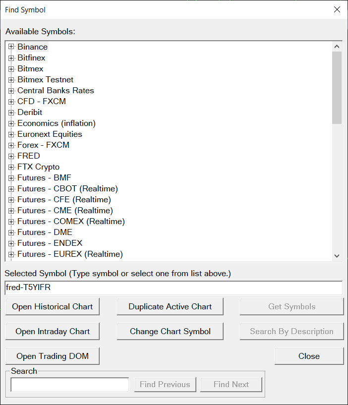
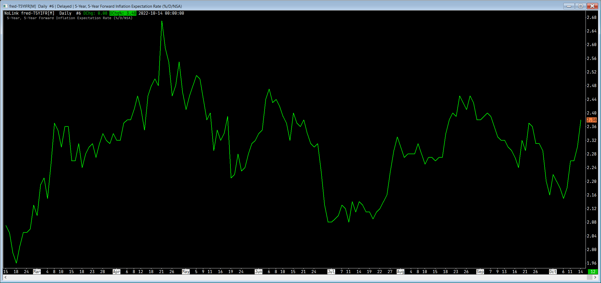

# [DTC protocol](https://www.dtcprotocol.org/) data provider for [Sierra Chart](https://www.sierrachart.com/)
Currently implemented data sources:
- [Fred Economic Data](https://fred.stlouisfed.org/docs/api/fred/)

## Use as [Fred Economic](https://fred.stlouisfed.org/docs/api/fred/) Data proxy
- Download SomeDataProvider.DtcProtocolServer from `Release` section.
- Get a [FRED API Key](https://fred.stlouisfed.org/docs/api/api_key.html).
- Configure the key in `appsettings.Local.json`, next to `appsettings.json` in the
  `SomeDataProvider.DtcProtocolServer` output folder. This file is git-ignored, so the
  real key never lands in the repository. Copy `appsettings.Local.example.json` to
  `appsettings.Local.json` and set `StoresOptions.Fred.ApiKey`:
  ```json
  {
      "StoresOptions": {
          "Fred": {
              "ApiKey": "<your FRED API key>"
          }
      }
  }
  ```
  `appsettings.Local.json` is loaded after `appsettings.json` and overrides it, so the
  empty `ApiKey` placeholder that ships in `appsettings.json` is fine to leave as-is.
- Run SomeDataProvider.DtcProtocolServer as `SomeDataProvider.DtcProtocolServer.exe start`
- In [Sierra Chart](https://www.sierrachart.com/) open `Global Settings` -> `Symbol Settings` and add single symbol with the following configuration:
  - Symbol: `fred-~`
  - Use Pattern Matching: `yes`
  - Category: `FRED`
  - Price Display Format: `0.01`
  - Supports Market Depth: `not supported`
  - Allow Zero Value: `allowed`
  - Generic Sub-Client Server Address: `127.0.0.1:50001`
  - Historical Data Server: `127.0.0.1:50001`
  - Historical Daily Data Source: `DTC historical data server`
  - Historical Intraday Data Source: `DTC historical data server`
  - Real-Time Data Client: `generic sub-clients`
- Now one can add any FRED symbol chart:
  - `Find Symbol` -> `Selected Symbol`: `fred-T5YIFR`\
  
  -  Graph should be display as:\
  

## T-Invest instruments, search, bar history and live data

T-Invest is a second, optional source. It provides complete security definitions, symbol search, bar history,
live trades, best bid/ask and market depth. Tick history and trading are not implemented yet; those requests are rejected.
FRED and the private series extension are unchanged; series requests remain FRED-only.
The source is off in the shipped `appsettings.json` (`TokenSource` is empty).

Copy the local example next to the server's `appsettings.json`. Select exactly one token source:

- `CredentialManager`: the recommended Windows generic credential. Store it yourself with
  `cmdkey /generic:SomeDataProvider/TInvest/Sandbox /user:sandbox /pass`.
  `/pass` without a value prompts for the token; do not put the token on the command line.
  For production use target `SomeDataProvider/TInvest/Production` and a read-only token.
- `Environment`: reads only `SOMEDATAPROVIDER_TINVEST_TOKEN` from the server process environment.
- `File`: reads only `StoresOptions:TInvest:Token` from the git-ignored `appsettings.Local.json`.
  This file is copied to local build output, but never published. Keep the token out of source control.

There is no fallback between sources. A missing credential, authentication failure or non-read-only production
account disables T-Invest and leaves FRED available. Sandbox startup calls `GetInfo` only. Production startup
checks `GetAccounts`: at least one account, all read-only. It never places orders. The logon text identifies
configured sources and the selected environment; the symbol/exchange delimiter stays empty.
Tokens are held outside the options object and redacted from all configured logging sinks, including exceptions
and structured properties. gRPC logging stays at Warning.

Settings under `StoresOptions:TInvest` (all are validated at startup):

| Setting | Default | Accepted values |
|---|---|---|
| `TokenSource` | empty (off) | empty, `CredentialManager`, `Environment`, `File`; case-sensitive |
| `Environment` | `Production` | `Production` or `Sandbox`; case-sensitive |
| `CredentialTarget` | omitted | 1–256 characters, not all whitespace, no control characters; omitted selects `SomeDataProvider/TInvest/<Environment>` |
| `SearchOnlyApiTradeable` | `true` | JSON boolean `true` or `false` |
| `MaxCandleCallsPerRequest` | `400` | integer 1–400, including time pages and any quota retry attempts |
| `IncludeDealerTrades` | `false` | JSON boolean `true` or `false`; include dealer/weekend trades and candles when true |
| `MaxStreams` | `4` | integer 1–32; each stream holds at most 150 instruments (300 trade/book subscriptions; info is free) |
| `MaxDepth` | `50` | 1, 10, 20, 30, 40 or 50; maximum upstream and downstream order-book levels per side |
| `StreamSilenceTimeout` | `00:03:00` | TimeSpan `00:00:30`–`00:15:00`, inclusive; no message of any kind for this long breaks the stream |
| `SessionQueueLimit` | `50000` | integer 128–100000 market updates per DTC session; control messages are never dropped |
| `RecordSymbols` | `[]` | array of unique `TICKER-CLASSCODE` strings, 3–128 ASCII letters/digits/`.`/`_`/`-` each; split at the last `-`, both parts required; no `fred` prefix; at most `150 × MaxStreams` entries |

The `Token` value is read only by the File source: it must be nonempty and not whitespace. Invalid setting
values fail startup with the setting name; errors never include the token. Endpoints are fixed TLS endpoints:
`sandbox-invest-public-api.tbank.ru:443` and `invest-public-api.tbank.ru:443`. Sandbox mode never calls production.
The gateway accepts normal system certificate trust and the official SDK's bundled Russian trusted root;
hostname checks are always enforced.

Sierra Chart Symbol Settings:

- Keep the existing `fred-~` entry. Add each T-Invest instrument as one combined `TICKER-CLASSCODE` symbol,
  with pattern matching off and no separate exchange. `SYNTH-TESTCC` illustrates the shape, not a real instrument.
- Use category `T-Invest`, the same generic sub-client and historical server addresses as the FRED entry,
  and enable `Supports Market Depth` for eligible shares, ETFs, bonds, futures and currencies. Options do not advertise depth.
- Set Real-Time Data Client to `generic sub-clients` and Generic Sub-Client Server Address to
  `127.0.0.1:50001` (or the configured streaming listener, not the history-only listener).
- Set Historical Data Server to `127.0.0.1:50001` (or your configured history listener address).
- Set Historical Daily Data Source and Historical Intraday Data Source to `DTC historical data server`.
- Bar downloads need a supported storage interval instead of 1 Tick or 1 Second. Sierra Chart's
  Global Settings > Data/Trade Service Settings > Common Settings > Intraday Data Storage Time Unit
  controls this, not the chart's display period; 1 Minute is supported. This is a global setting affecting
  other charts too, so use a separate Sierra Chart installation if their storage must stay at 1 Tick.
  The bridge never changes Sierra Chart settings. Tick requests still receive a stage reject.
- Daily and supported intraday bar charts, live trades, best bid/ask, DOM and Time and Sales are usable now.
  Tick-storage history downloads still reject until the tick-history stage.
- After this stage is committed, check the bridge in Sierra Chart: open one configured T-Invest symbol during exchange
  trading, verify Time and Sales and best bid/ask updates, then open its DOM and confirm the requested depth is populated.
  A quiet/closed exchange may leave the DOM unchanged; it is not evidence that depth encoding failed. If a subscription
  rejects, report the Sierra Chart version and Message Log text; a legacy-message fallback is a separate follow-up,
  not enabled speculatively. This server does not change Sierra Chart settings or files.

DTC clients can instead send a ticker and class code as separate Symbol and Exchange fields. Definitions echo
whichever form the request used. Bare tickers are never guessed. On the first combined request after restart,
the bridge tries an exact `GetInstrumentBy` lookup for that ticker/suffix; misses are cached for ten minutes.
Successful definitions are cached and refreshed daily at 03:00 UTC. Failed refreshes are retried on demand;
expired entries are never served. No bulk instrument-list calls are used. Current live subscriptions keep the UID
resolved when they opened: a daily definition refresh that reassigns a ticker to another UID does not migrate them.
Resubscribe the chart to resolve the new UID; restart the bridge to refresh a watch-list subscription in that case.

Search returns T-Invest matches first, then FRED (unless an exchange or security type restricts it).
A `fred-` search stays FRED-only. Results filter empty class codes, unsupported kinds and, by default,
non-API-tradeable instruments. Exact ticker matches precede prefixes in by-symbol searches.
Only complete definitions are sent: up to 20 cold instruments hydrated within an eight-second budget,
and up to 50 already-cached rows. Futures and bonds need a second metadata call, and options also resolve their underlying position, so fewer rows
can fit. The last row is final, not a promise that all upstream matches were returned.
A selected result can be looked up exactly without losing its price increment or currency.

### Live subscriptions, recording and outages (stage 3)

Live data is supported for shares, ETFs, bonds, futures and currencies; options remain definitions-only.
Sessions share reference-counted subscriptions by instrument UID. Each instrument uses exchange trades,
an exchange depth-1 book for best bid/ask, and trading status. Changes coalesce for 20 ms into one request per kind;
all streams and reconnects share the subscription and address limits below. A subscribe or snapshot-only request
gets its snapshot or a reject within 20 seconds, including lookup and admission. An unsubscribe releases only that
session's reference. Snapshot-only requests use cached state or the three unary calls, never create a stream subscription,
and do not cancel an existing live subscription with the same SymbolID.

Quiet instruments bootstrap from `GetLastPrices`, `GetOrderBook` and `GetTradingStatus`; later subscribers use
the shared current state. Missing fields stay unset. Live trades and bid/ask use DTC V2 messages with microsecond
timestamps (source nanoseconds are truncated, never rounded or made unique). Quantities are lots multiplied by
the instrument's lot size. Buy trades are at ask, sells at bid, unknown direction is unset. Equal microsecond trade
times are legal and are not deduplicated. Best bid/ask is sent only on a price or quantity change; empty sides have unset prices and zero quantities.

### Market depth and DOM (stage 4)

Market depth is available for shares, ETFs, bonds, futures and currencies; option definitions do not advertise it.
`TInvest:MaxDepth` defaults to 50 and accepts only `1`, `10`, `20`, `30`, `40` or `50`; other values are rejected at startup. A DTC request with `NumLevels=0` asks for 10; other requests are capped by `MaxDepth`. Shared upstream book subscriptions round client demand up to 1, 10, 20, 30, 40 or 50, then cap the result at `MaxDepth`. Each client receives no more than its requested level count.

A quiet book is bootstrapped by unary `GetOrderBook` within the subscription's 20-second deadline. Stream books older
than the current book are ignored. An inconsistent book invalidates the current DOM state; incremental updates are
suppressed until a consistent full book arrives, then clients receive a complete snapshot. When a deeper client joins a
symbol already used for best bid/ask, the shared upstream book is resubscribed at the higher depth and its new snapshot
updates both the DOM and derived best bid/ask.

Every DTC snapshot is one atomic batch: the first frame has `FINAL_UPDATE_BEGIN_BATCH` and the last has
`FINAL_UPDATE_TRUE`, including empty and one-level books. A depth update uses DTC V2 timestamps in milliseconds;
quantities are lots multiplied by the instrument lot size. If a session's bounded queue cannot retain a complete depth
update, it replaces that symbol's queued deltas with the latest full snapshot and sends that snapshot before any later
depth update. These local drops contribute to the next heartbeat's `NumDroppedMessages` count.

Trading status mapping (both snapshots and `TRADING_SYMBOL_STATUS`):

| T-Invest status | DTC status |
|---|---|
| NormalTrading, SessionOpen | OPEN |
| OpeningPeriod, OpeningAuctionPeriod, SessionAssigned | PRE_OPEN |
| BreakInTrading | TRADING_HALT |
| NotAvailableForTrading, ClosingPeriod, SessionClose | CLOSE |
| Unspecified, ClosingAuction, DiscreteAuction, DarkPoolAuction, TradingAtClosingAuctionPrice, StabilizationAuction, all dealer-only statuses, any future unknown value | UNKNOWN |

`IncludeDealerTrades=false` excludes dealer/weekend prints from the stream and snapshot last prices, as well as candles.
The tick recorder always records exchange trades only, regardless of that display option. To start recording without
a connected DTC client, set a watch list in the local T-Invest section, for example `"RecordSymbols": ["SYNTH-TESTCC"]`
(invented symbol; replace it with your own). Initial lookup/subscription failures are retried every 30 seconds;
they prove no coverage. Watch-list admission does not spend unary snapshot calls. Once admitted, the watch list keeps
its references until shutdown and follows stream reconnects.

The recorder writes outside the repository under `%LOCALAPPDATA%/SomeDataProvider/tinvest-today/<hashed-uid>/`:
UTC-day `.bin` files preserve source nanoseconds and lots, and `.coverage.json` files describe live intervals.
Ticks and conservative coverage are flushed every second. Coverage stops at the last received stream message minus
a one-second latency margin, never at the watchdog's later detection time. A broken stream or restart leaves a hole,
even if no trade was observed. Disk work is separate from hub delivery; old-day handles close at midnight, and only
changed manifests are written. A failed disk write or recorder-queue overflow stops extending recorded coverage.
Answering tick history, merging the last hour,
and archive-driven cleanup belong to the later tick-history stage; recording now does not make tick downloads available.

During a T-Invest outage, affected symbols receive feed-unavailable once; FRED stays usable. The hub reconnects
with 1, 2, 4 … 30-second backoff and ±20% jitter, resubscribes through the shared quota, and verifies the subscriptions
with `GetMySubscriptions`; omitted subscription kinds are empty after a bounded collection interval. A mismatch is
retried once, then stays unavailable while delayed retries run every 30 seconds. Local quota deferrals reject only
waiting subscribers at their deadline, not healthy streams. Successful symbols
receive feed-available; logon advertises `ResubscribeWhenMarketDataFeedAvailable=1`, so DTC clients resubscribe with their
existing SymbolIDs and get fresh snapshots. No unsolicited restoration snapshot is pushed. Sierra Chart may show a data
interruption; until tick history lands, missing live ticks cannot be backfilled through this server.

The stream requests 10-second idle pings. T-Invest sends them only while no data flows, so active samples
without pings are inconclusive for Q-3, not evidence of a broken stream. On November 1, 2026 the bounded sandbox
sample received six pings, with intervals of 10,999, 11,000, 11,000, 11,001 and 11,000 ms; the longest gap between
any two messages was 11,001 ms. No trades or quotes arrived, but the snapshot status was DealerNormalTrading,
which the conservative quiet-stream rule excludes. The check was therefore inconclusive, not a qualifying Q-3 pass.
The 180-second default remains provisional; the production quiet-stream check in the tick-history stage must
confirm it. No more sandbox retries are authorized. Any upstream message, not just a ping, proves liveness.
The explicit `SamplesLiveStreamThroughHub` sandbox test samples for 70 seconds after subscription (at most 110 seconds
overall). Every run prints subscription statuses, counts by kind, snapshot trading-status name, elapsed time,
attempts, ping count/intervals and the longest gap between upstream messages; no market payload values are printed.
A quiet sample has no trades or quotes and a known non-normal-trading status; it requires at least three pings,
and the default timeout must exceed three times the longest ping interval. An active or unknown-status sample
is inconclusive for Q-3. Select the test with
`--filter FullyQualifiedName~SamplesLiveStreamThroughHub` and the same sandbox variables/helper described below.

Slow DTC sessions have separate bounded market-update queues; control frames (snapshots, rejects, feed/trading status,
heartbeats and history) are not dropped. A full queue drops new market updates for that session only. Each heartbeat's
`NumDroppedMessages` is the count since the previous heartbeat: one drop reports 1, then 0 if no new drop, then 1 again
for a new later drop. Upstream gaps are feed status, never an invented drop count. A dropped best quote is resent with
its latest values when room returns, even if the source does not change again. A local depth drop removes that symbol's
queued deltas and keeps only its latest full snapshot; the snapshot batch is sent before later depth updates for that symbol.
Queued values are purged on unsubscribe.

Limits use shared rolling windows at 90%: instruments 180/minute, market data 540/minute, users 90/minute,
subscriptions 90/minute, archives 27/minute, and all attempts 45/second. Response rate-limit headers can reduce
admission further. Definitions/search wait at most eight seconds, then reject with a retry-in hint; exhausted
calls retry at most once, only if the reset fits the same deadline. No upstream error text is sent to clients.
HTTP 429 handling belongs to the later archive-download HTTP transport; this stage uses gRPC unary calls and
handles the API's `RESOURCE_EXHAUSTED` quota status. An unexpected HTTP 429 in gRPC is a safe source failure.

Gateway construction follows approved amendment A-7 (task `t_2288470e`, user approval recorded October 31, 2026):
it builds one authenticated gRPC channel and the SDK's generated service clients directly. The pinned
`Tinkoff.InvestApi` `[0.6.25]` factory hides three retries, bypassing bridge admission; it is deliberately not used.
There is no retrying SDK invoker or channel retry policy. Each upstream attempt passes through the shared limiter.
Both sandbox and production TLS use only the SDK's bundled Russian Trusted Root CA as their custom trust anchor,
not the machine's root store. Certificate downloads and revocation network checks are disabled. The native chain
policy still requires server-authentication usage, a valid chain to that root and the correct host name; a missing
certificate is rejected. No OS trust-store change or accept-all callback is used.
The stream sandbox check reports DNS, connect, TLS and first-answer timings without inspecting event payloads;
incomplete startup steps are reported explicitly. These diagnostics are test-only. The November 1 sample measured
DNS 3 ms, connect 2 ms, TLS 63 ms and first answer at 186 ms; access took 195 ms, definition 58 ms and subscription
240 ms (494 ms startup total). A prior eight-second startup timeout remains unexplained; the production startup
uses the same eight-second budget. The token-free TLS preflight received HTTP 404 in 261 ms through this handler.

Offline checks (no FRED or T-Invest calls):

```
dotnet build src/SomeDataProvider.sln
dotnet test src/SomeDataProvider.DtcProtocolServer.Test --no-build --no-restore
dotnet test src/SomeDataProvider.DataStorage.TInvest.Test --no-build --no-restore
```

The explicit `TInvestSandbox` test is never part of a default/CI run. It requires `TINVEST_SANDBOX_SYMBOL` and
`TINVEST_SANDBOX_EXCHANGE` in the command environment, and uses only the sandbox. On Windows, run it locally
with `tools/with-credential.ps1 -Target SomeDataProvider/TInvest/Sandbox -Variable TINVEST_SANDBOX_TOKEN`
followed by `dotnet test src/SomeDataProvider.DtcProtocolServer.Test --no-build --no-restore --filter Category=TInvestSandbox`.
Invoke the helper with `powershell.exe -NoProfile -ExecutionPolicy Bypass -File`. It reads Credential Manager
without printing the value and clears the child environment afterwards. Output is structural only.

### T-Invest history limits (stage 5a)

Bounds are whole UTC seconds and half-open `[start, end)`: a candle at the end belongs to the next piece.
Start 0 selects the earliest available candle date. For second candles this is the later of the 30-day retention
boundary (rounded up to a whole second) and the instrument's first-minute candle date; missing instrument metadata
uses that retention boundary. An earlier explicit start is clamped to the instrument's first candle date,
but an explicitly requested second-candle start older than 30 days is rejected before clamping.
End 0 or a future end selects the current frontier and permits the newest unfinished candle as the last record.
Closed requests contain complete candles only. OHLC prices retain their source units; volumes are lots multiplied
by the instrument's lot size, and the trade count is 0 because candles do not supply it. FRED's bounds are unchanged.

| Interval | API maximum period | Maximum candles per time page |
|---|---|---|
| 5 / 10 seconds | 200 minutes | 2,500 / 1,250 |
| 30 seconds | 20 hours | 2,500 |
| 1 / 2 / 3 minutes | 1 day | 2,400 / 1,200 / 750 |
| 5 / 10 minutes | 1 week | 2,400 / 1,200 |
| 15 / 30 minutes | 3 weeks | 2,400 / 1,200 |
| 1 / 2 / 4 hours | 3 calendar months | 2,400 / 2,400 / 700 |
| 1 day | 6 calendar years | 2,400 |
| 1 week | 5 calendar years | 300 |
| 1 month, if requested by a DTC client | 10 calendar years | 120 |

Intraday time pages also split at UTC midnight. Pages are sized in advance so even a continuously traded
instrument cannot exceed the candle cap. The API rejects combining `limit` with an explicit candle source
(30220), so the gateway omits `limit` and enforces the cap with these time bounds. Candles are exchange-only
unless `IncludeDealerTrades` is true. Second candles are restricted to the last 30 days; older requests reject
before the header. Intraday availability starts at `first_1min_candle_date`; daily/weekly/monthly availability
starts at `first_1day_candle_date`. Missing earliest-date metadata requires an explicit start for minute and
higher intervals; second candles instead use the retention boundary as described above.

The 400-call default fits a year of minute bars (at most 366 UTC-day pages). Longer ranges, unsupported intervals
(including 1, 2 and 4 seconds) and invalid bounds reject before the header. Reduce the requested range to retry.
Every planned call reserves shared service and address quota before the header. If that plan cannot fit inside
the shared windows, the request is not admitted. History downloads use at most 40 of the 45 calls per second,
including quota retries, and leave five for definitions and other control calls, also while a download runs
late: each history call counts once, as a booked call until it is sent and as an actual call afterwards. The
booked calls of all downloads form one queue paced at 40 per second from now, so concurrent downloads share that
pace and neither waits behind the other's booked calls. A new download is admitted only if every booked call,
its own included, fits its admission budget at that pace, after any source quota block and within the service
window. Unused booked calls keep their service and address quota until the download ends or fails; a download
never waits behind its own booked calls, also after a header lowers the service limit. Server quota corrections
compare against actual upstream admissions, not unused reservations. If a reservation cannot finish within the
20-second admission budget, the answer is a DTC retry-in reject with 1–300 seconds, not partial history.
If reported source quota is smaller than a plan's call count, the same plan continues to receive retry-in;
request a shorter range instead. No fixed setting can override a lower upstream quota.
After the header a source failure or a wait longer than 20 seconds closes the entire DTC connection with no final
record and no post-header reject, including other work if a client multiplexes history on the main listener.
Clients should use a dedicated history connection, discard an incomplete download and retry it.

A seeded simulation checks the limiter on a fake clock with concurrent downloads, slow and failing calls,
lookups, subscription/reconnect storms, quota corrections and exhausted quota. It checks every rolling window of
actual-plus-booked address/history traffic and the effective service schedule, not only the window ending now.
Booked times move with actual progress and source quota blocks; original reservation timestamps are ordering keys,
not fixed send times. The normal test run includes a short fixed-seed run. The long
run (200 seeds of ten simulated minutes each) is local and on demand only:

```
dotnet test src/SomeDataProvider.DataStorage.TInvest.Test --no-build --no-restore --filter Category=TInvestLimiterSimulation
```

The explicit `ReadsOneMinuteDayThroughBridgeHistoryReader` sandbox check downloads one recent weekday of
1-minute exchange candles through the production history reader. Output contains only counts, ordering flags
and first/last times relative to the day, never prices or volumes. It uses the same environment variables and
credential helper as the definition/search check above; select it by `--filter FullyQualifiedName~ReadsOneMinuteDayThroughBridgeHistoryReader`.

## Session lifetime and heartbeats
`LOGOFF` from a client closes its connection immediately, stops its timers, and cancels any running requests,
including history downloads. The server queues no further responses after processing `LOGOFF`.

On the streaming server, a successful `LOGON_REQUEST` enables heartbeats at the requested interval of 1 to 300
seconds. If no complete client message arrives for twice that interval, the server cancels the session's requests
and closes the connection. Any complete message counts as activity, not just `HEARTBEAT`; partial frames do not.
An interval of 0 disables heartbeats in both directions and disables loss detection. Negative intervals are clamped
to 0, and intervals above 300 seconds are clamped to 300. The history-only server never sends heartbeats or runs
loss detection, regardless of the requested interval. Client `LOGOFF` still closes a history-only session.

## Series extension
Both servers, the streaming and the history-only one, implement version 1 of MrktPltfrm's private DTC series extension
(`docs/dtc-series-extension.md` in MrktPltfrm, private Types 20000 to 20006, binary encoding with variable-length
strings only). The server keeps no handshake state: it answers `SERIES_METADATA_REQUEST` and
`SERIES_VINTAGES_REQUEST` whenever they arrive, each with its answer or exactly one `SERIES_REQUEST_REJECT`.
- Symbols are `fred-<SERIES_ID>`, optionally with a units suffix such as `.pch`, with an empty Exchange.
- Metadata comes from FRED's `fred/series`. Units are the base series'; the suffix only sets the units
  transformation.
- Vintages come from FRED's `fred/series/observations` with `output_type=1`: one row per observation and real-time
  period, in ascending observation date and then real-time start, keeping FRED's clipping to the requested real-time
  window. A real-time bound of 0 asks for 1776-07-04 or 9999-12-31; FRED's `.` is a row without a value; `ReleaseTime`
  is 0. Rows go out page by page as FRED returns them: a page's complete observation dates are sent before the next
  page is fetched, and a date whose rows continue on the next page waits for that page.
- A missing series is rejected as an unknown symbol; FRED's rate limit, outages and API key problems as source
  unavailable, with a retry hint of 1 to 3,600 seconds when one is known.

## Build from source
`SomeDataProvider.DtcProtocolServer` uses `Dtc.Protocol`, the DTC message library of the author's MrktPltfrm
project, which is not on nuget.org. `nuget.config` restores it only from the local folder feed
`I:\Projects\LocalNuGet`, and the project pins its exact version. Before the first build, pack that version of
`Dtc.Protocol` and add it to the feed with `dotnet nuget push <nupkg> -s I:\Projects\LocalNuGet`. `nuget.config`
explains how to use another folder.